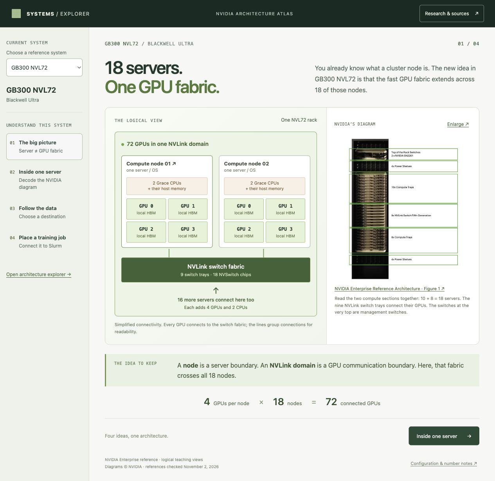
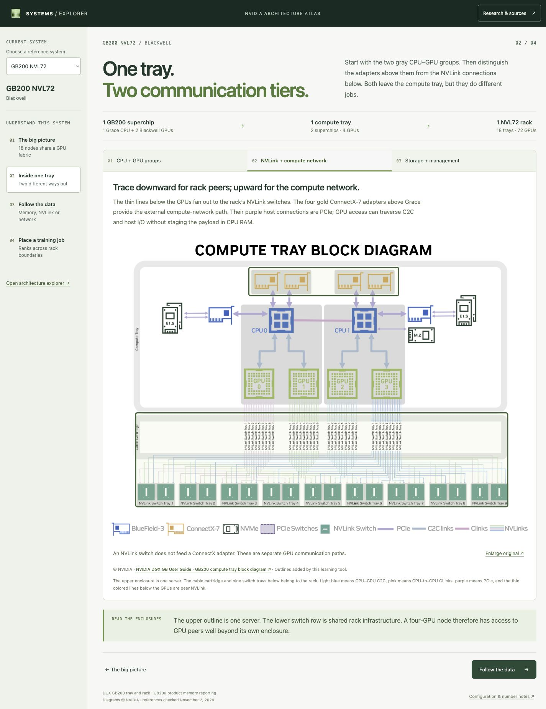
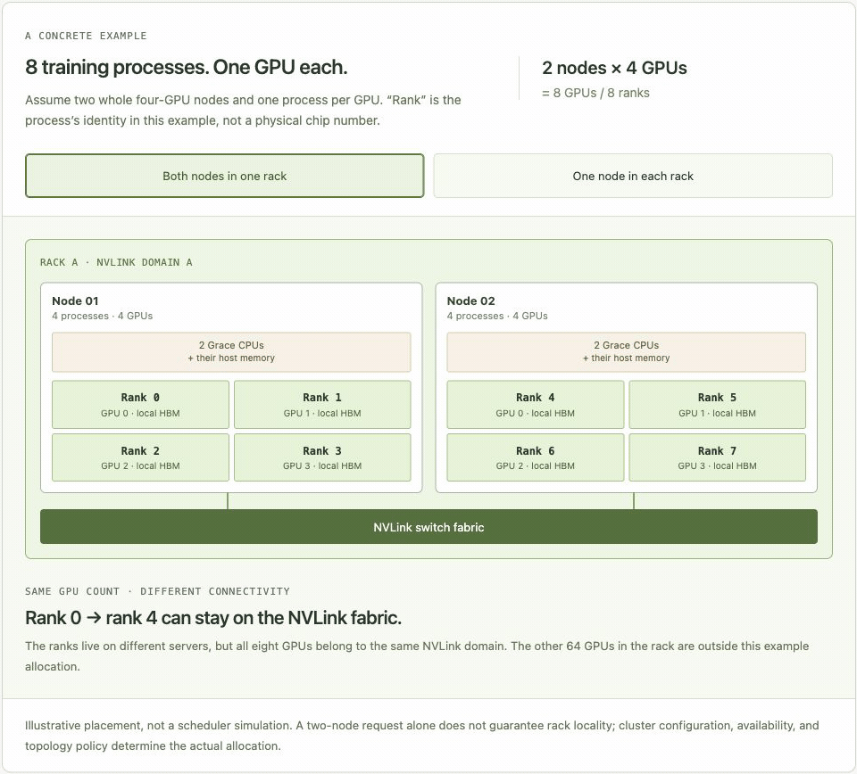

# NVIDIA Systems Explorer

An interactive guide to how NVIDIA GPUs, memory, servers and racks connect. Runs locally in your browser; no GPU required.



*The GB300 NVL72 overview: compute nodes, the shared GPU fabric, and the physical rack.*

## Run

Requires Node.js 18+. No dependencies to install or build step.

```sh
git clone https://github.com/smith-nathanh/nvidia-gpus.git
cd nvidia-gpus
npm start
```

Open [localhost:4173](http://127.0.0.1:4173/). Use `PORT=4174 npm start` for another port.

## What's inside

Each system has a four-part lesson: the big picture, an annotated NVIDIA diagram, data paths, and a small workload example. Change a job's placement or a buffer's memory location to see what changes in the hardware path.

The detailed explorer lets you move from rack or system to node to GPU, inspect components, and follow their sources. Views can be bookmarked, and the controls work with a keyboard.

| Reference type | Systems |
| --- | --- |
| Eight-GPU servers | DGX H100, H200, B200 and B300 |
| Rack-scale systems | GB200 NVL72, GB300 NVL72 and Vera Rubin NVL72 |
| Single-superchip and personal systems | GH200 HBM3e, DGX Spark and DGX Station |

<details>
<summary>More views and an interactive example</summary>

**Reading a compute-tray diagram**



**Changing a job's placement**



</details>

## Sources and scope

These are selected reference configurations, not every SKU. The app links to primary sources and calls out differences between publications. Diagrams show architectural relationships; workload examples illustrate placement and memory budgets, not measured performance.

NVIDIA figures retain their attribution and [provenance](dist/assets/nvidia/README.md). Supporting [source notes](docs/research/) are included. The app loads locally without external APIs or accounts; following source links needs internet access.

## Development

`dist/` is hand-authored source. Edit it directly and reload the browser; there is no hot reload.

```sh
npm run check
```

Checks cover the hardware models, lessons, diagrams, local assets and navigation. Use the browser to check layout and interactions after UI changes.
